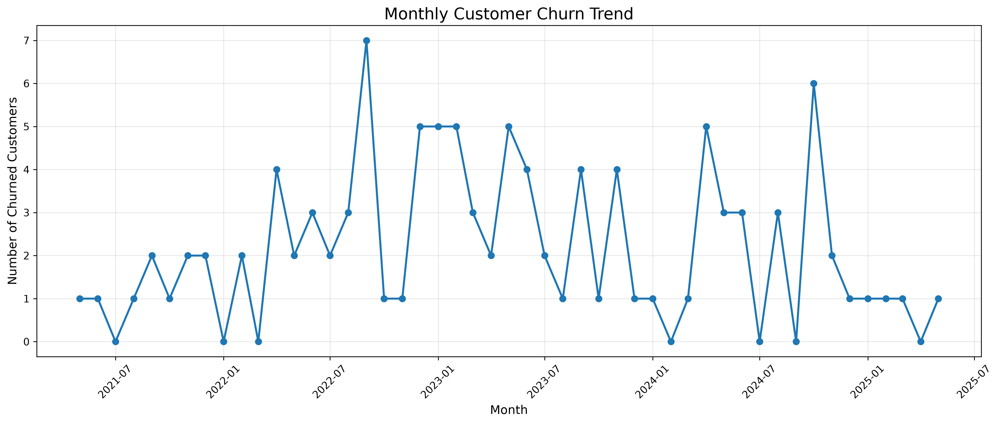

# DataOps Intern Assignment

## Overview

This repository contains the implementation of a DataOps Intern Assignment covering data analysis, Excel/Google Sheets, SQL, and Python-based data cleaning and visualization.

The assignment focuses on customer analysis, vendor fulfillment performance, regional revenue insights, SQL queries, and monthly customer churn trends.

## Tech Stack

- **Excel / Google Sheets:** Data analysis, formulas, aggregations, and reporting
- **MySQL:** Database creation, data management, and SQL queries
- **Python 3.12:** Data cleaning and analysis
- **Pandas & NumPy:** Data manipulation and numerical operations
- **Matplotlib:** Data visualization
- **Jupyter Notebook:** Interactive analysis

## Assignment Tasks

### Q1. Customer Analysis

- Calculated total delivered quantity for each customer using `SUMIF`.
- Categorized customers based on Monthly Recurring Revenue (MRR).
- Applied the following classification:
  - Enterprise: MRR >= $1,000
  - SMB: MRR < $1,000

### Q2. Vendor Fulfillment Analysis

- Calculated total submitted and delivered quantities for each vendor.
- Calculated vendor fulfillment rates.
- Identified the second-highest and lowest fulfillment rates.
- Analyzed the potential impact of low fulfillment on customer retention and MRR.

**Key Findings:**
- Second-highest fulfillment rate: Alpha Supplies (89.09%)
- Lowest fulfillment rate: Beta Logistics (84.85%)

### Q3. Regional Revenue Analysis

- Calculated active customer counts by region.
- Aggregated regional MRR.
- Calculated average MRR per active customer.
- Identified the region with the highest revenue per active customer.

**Key Findings:**
- Highest total MRR: West ($2,650)
- Highest average MRR per active customer: East ($1,500)

### Q4. SQL Analysis

Created a MySQL database named `dataops_assignment` with two tables:

- `customers`
- `orders`

Performed the following queries:

1. Retrieved active customers with MRR greater than $500.
2. Calculated total submitted and delivered quantities grouped by vendor.

**Database:** MySQL

### Q5. Python Data Cleaning & Churn Analysis

Used the Table 3 dataset to perform customer data cleaning and monthly churn analysis.

**Data Cleaning:**
- Loaded the Excel dataset using Pandas.
- Inspected missing values and data types.
- Checked for duplicate records.
- Removed an irrelevant unnamed Excel column after inspection.
- Standardized text fields.
- Converted date columns into datetime format.
- Preserved missing end dates for active customers.

**Churn Analysis:**
- Total customers: 200
- Active customers: 94
- Churned customers: 106
- Calculated monthly churn counts using the `EndDate` column.
- Visualized monthly churn trends using Matplotlib.

**Key Finding:**

September 2022 recorded the highest monthly churn, with 7 customers.

The visualization is saved at:

`output/monthly_churn_trend.png`

## Project Structure

```text
dataops-intern-assignment/
│
├── data/
│   └── assignment.xlsx
│
├── output/
│   └── monthly_churn_trend.png
│
├── Q5_Churn_Analysis.ipynb
│
├── requirements.txt
├── .gitignore
└── README.md
```

## Installation & Setup

### 1. Clone the repository

```bash
git clone https://github.com/YOUR_USERNAME/dataops-intern-assignment.git
cd dataops-intern-assignment
```

### 2. Create a Python 3.12 virtual environment

```bash
py -3.12 -m venv venv
```

### 3. Activate the environment

Windows CMD:

```bash
venv\Scripts\activate
```

Windows PowerShell:

```powershell
.\venv\Scripts\Activate.ps1
```

### 4. Install dependencies

```bash
pip install -r requirements.txt
```

### 5. Launch Jupyter Notebook

```bash
jupyter notebook
```

Open `Q5_Churn_Analysis.ipynb` and execute the notebook cells.

## SQL Setup

Create the database in MySQL:

```sql
CREATE DATABASE dataops_assignment;
USE dataops_assignment;
```

Create the `customers` and `orders` tables using the SQL definitions and sample data from the assignment.

Execute the queries documented in the Q4 section of the assignment.

## Results & Deliverables

| Task | Deliverable |
|---|---|
| Q1 | Customer quantity and tier analysis |
| Q2 | Vendor fulfillment analysis |
| Q3 | Regional MRR analysis |
| Q4 | MySQL queries and results |
| Q5 | Cleaned dataset, churn analysis, and visualization |

## Tools & Libraries

```text
Python 3.12
Pandas
NumPy
Matplotlib
OpenPyXL
Jupyter
MySQL
Microsoft Excel
```
## Monthly Customer Churn Trend



## Author

**Utkarsh Srivastava**